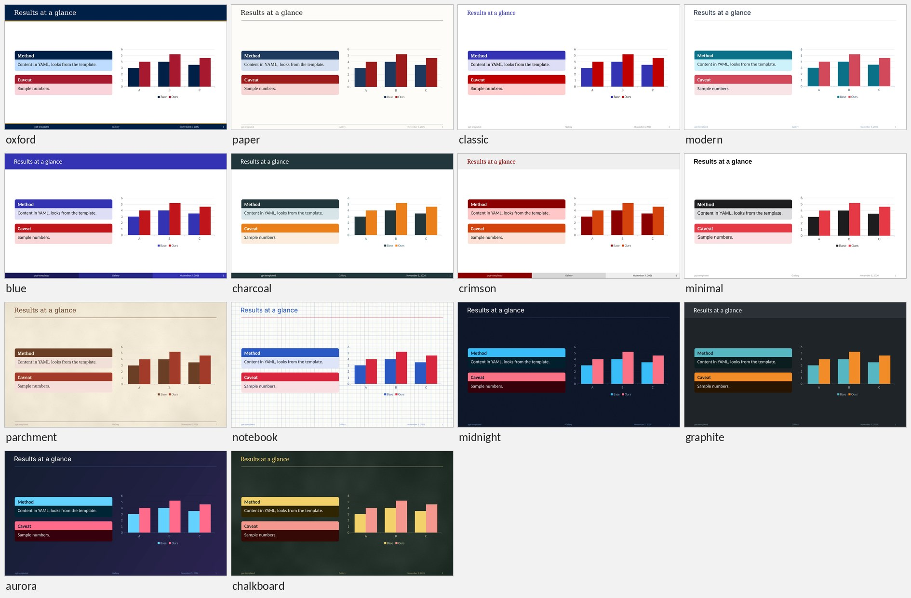

# ppt-templated

**Beamer-style, fully editable PowerPoint decks from a small YAML file.**

Write what goes on each slide in YAML, pick a template, run one command, and get a normal `.pptx`.
Positions, sizes, fonts, colours and backgrounds are worked out for you, so the writing (by a person
or an AI agent) is about the content only; anyone can keep editing the result in PowerPoint.

```
talk.yaml  +  template  ──ppt_templated.py──▶  talk.pptx  (+ slide previews, layout check, JSON report)
 (what)       (how it looks: 14 bundled, light and dark)      (native, editable)
```



---

## Contents

- [Quick start](#quick-start)
- [What you get](#what-you-get)
- [Templates](#templates)
- [For AI agents](#for-ai-agents)
- [Example decks](#example-decks)
- [Documentation](#documentation)
- [YAML at a glance](#yaml-at-a-glance)
- [Working loop](#working-loop)
- [Good to know](#good-to-know)
- [Project layout](#project-layout)
- [Maintaining the docs](#maintaining-the-docs)

---

## Quick start

```bash
pip install -r requirements.txt     # python-pptx, pyyaml, pillow, lxml, matplotlib, numpy, pandoc, pymupdf
python ppt_templated.py examples/example.yaml --preview
```

Python 3.9+. PowerPoint is needed only to *open* decks (and, on Windows, gives the most exact previews);
LibreOffice renders previews on any OS.

```bash
python ppt_templated.py --new talk.yaml -t midnight               # a starter file
python ppt_templated.py talk.yaml                                  # → talk.pptx (or meta.output)
python ppt_templated.py talk.yaml --preview                        # + slide PNGs, contact sheets, layout check
python ppt_templated.py talk.yaml --check --json                   # validate only; machine-readable report
python ppt_templated.py talk.yaml -t parchment                     # same content, other look
python ppt_templated.py --templates                                # the bundled templates
python ppt_templated.py --inspect "Company Template.potx"          # what a template provides
python build_template.py --spec my_theme.yaml                      # a new template from a theme file
```

From Python: `from ppt_templated import build_deck; build_deck("talk.yaml", "talk.pptx")`.

## What you get

| In the YAML | In PowerPoint | Editable afterwards |
|---|---|---|
| title / section / outline / bullets | Real placeholders from the template layouts | Yes; layouts can be re-applied |
| `layout: statement` | One big message, sized to fill the slide | Yes |
| `block`, `alertblock`, `exampleblock` | Grouped shapes in theme colors; blocks side by side share one height | Yes |
| `cards`, `timeline`, `quote` | A grid of cards, a row of dated events, a pull quote — laid out automatically | Yes |
| `chart` | **Native chart** | Yes: right-click → Edit Data |
| `plot` | Figure (bar, box, line, scatter, histogram, heatmap, confusion matrix, **formulas**, **your own matplotlib code**) as a **vector** in the template's fonts and colors | Regenerate from YAML |
| `table` | **Native table** (booktabs / striped / grid / plain), auto widths | Yes |
| `data: results.csv` | Tables, charts and plots read their numbers from CSV/TSV/JSON files | Regenerate from YAML |
| `math`, `$inline$` | **Native equation** (needs pandoc) | Yes, in the equation editor |
| `image`, `images` | PNG/JPG as is; **SVG and PDF as vectors** with a PNG fallback sized to the slide; a row of figures at one height | Yes |
| `stats` | A row of key numbers with labels | Yes |
| `flow`, `steps` | **Flowcharts and workflows**: native shapes and glued connectors, laid out automatically | Yes: drag a shape, its arrows follow |
| `placeholder` | Dashed box reserving space for a figure you haven't made yet | Yes: Shape Fill → Picture |
| `layout: references` / `closing` | Numbered references split over as many slides as needed / a thank-you slide | Yes |
| `overflow: split` | Long lists and tables continue on `Title (2/3)` slides by themselves | Yes |
| `meta.logo` | A logo on every slide, placed clear of the title | Yes |
| `build`, `animate`, `transition` | **Native animations** and transitions, including **Morph** | Yes |
| `code`, `notes` | Monospace box, speaker notes | Yes |

Every build checks the YAML: unknown keys, bad values and overfull slides are reported with the slide
and a suggested fix. `--preview` renders the slides and measures the real layout (PowerPoint on
Windows, LibreOffice + PyMuPDF anywhere).

## Templates

All in `templates/`; pick one by name with `meta.template: midnight` or `-t midnight`.
`--templates` prints this list; every content file works with every template, light or dark.

| Template | Mode | Look |
|---|---|---|
| **`oxford`** ★ default | light | Navy title bar with gold stripes, square title box; Constantia / Cambria |
| `paper` | light | Journal look: hairline rules, grey text footline; Georgia / Times New Roman |
| `classic` | light | Blue frame titles, no bars (Beamer `default`); Cambria |
| `modern` | light | White, hairline under titles, left-aligned covers; Calibri |
| `blue` | light | Blue title bar and footline boxes (Beamer `Madrid`) |
| `charcoal` | light | Dark slate title bar, orange alerts (Beamer `metropolis`) |
| `crimson` | light | Light grey title bar, dark red titles (Beamer `Beaver`) |
| `minimal` | light | Black on white, bold titles, a single red accent; Arial |
| `parchment` | light | **Paper texture**, sepia ink, rules; Georgia / Cambria |
| `notebook` | light | **Graph-paper** background, ink-blue titles, red-pen accents |
| `midnight` | dark | Deep slate with fine grain, sky-blue structure, coral alerts |
| `graphite` | dark | Graphite title bar, teal structure, orange alerts (metropolis, dark) |
| `aurora` | dark | Blue-to-violet **gradient**, cyan structure |
| `chalkboard` | dark | **Blackboard** texture, chalk-white text, chalk-yellow titles |

Your own or your company's template, a new theme (dark mode, gradients, generated paper/grid/chalk
textures, pictures): [TEMPLATE_GUIDE.md](TEMPLATE_GUIDE.md).

## For AI agents

[AGENTS.md](AGENTS.md) is the short, prescriptive guide: the loop, what never to set, which item fits
which content, and how to read the JSON report. In short:

- `--new` gives a valid starter; `--check --json` validates in about a second and returns
  `{"ok", "warnings": [{"slide", "message"}], "slide_info": [{"fill", "text_scale", ...}]}`.
- No sizes, positions, fonts or hex colours in the YAML: the tool decides, the same way every time.
- Long content splits itself (`overflow: split`); numbers come from files (`data:`); formulas are
  plotted from the formula (`type: function`).
- `--preview --json` adds `(measured)` warnings from the rendered slides, so overlaps are found
  without looking at images.

## Example decks

| File | Topic | Shows |
|---|---|---|
| `examples/example.yaml` | ppt-templated itself | Every feature once (try it with `-t midnight`) |
| `transformer/transformer.yaml` | The Transformer architecture | A math-heavy lecture with figure placeholders |
| `segmentation/segmentation.yaml` | Image segmentation methods | A draft deck: placeholders and sample plots |

Build any of them from anywhere, e.g. `python ppt_templated.py segmentation/segmentation.yaml`.

## Documentation

| Document | Read it to |
|---|---|
| **[AGENTS.md](AGENTS.md)** | write decks as an AI agent: the short version |
| **[YAML_GUIDE.md](YAML_GUIDE.md)** | write a content file: **the complete reference** (every key, value and default, figures, plots, data files, flows, colors, animation, layout rules, recipes, messages) |
| [TEMPLATE_GUIDE.md](TEMPLATE_GUIDE.md) | build a template from a theme file, adapt a company template, or restyle one |
| this README | get an overview |

You should not need to read the Python files to write a deck; if you do, the guide is missing something.

## YAML at a glance

```yaml
meta:
  title: My Talk
  author: Jane Doe
  date: today
  template: oxford          # or midnight, parchment, ... (--templates)
  overflow: split           # long lists / tables continue on more slides

slides:
  - layout: title

  - title: Our method in one picture
    content:
      - columns:
          - - image: assets/method.svg            # SVG/PDF/PNG: converted and sized automatically
          - - bullets:
                - "Accuracy up by ==4.2 points=="
                - - on all three datasets
                - 'Loss: $\mathcal{L} = -\sum_t \log p(y_t)$'
              build: true

  - layout: statement
    text: Same accuracy at a tenth of the cost

  - title: Results
    content:
      - stats:
          - {value: "+4.2", label: accuracy points}
          - {value: "3×", label: faster inference}
      - table: {data: results/summary.csv, select: [Model, Accuracy]}

  - title: Why it works
    content:
      - cards:
          - {title: Sparse, text: "Only 10% of weights are active"}
          - {title: Cached, text: "Keys are reused across steps"}
          - {title: Batched, text: "One kernel per layer"}

  - title: Pipeline
    content:
      - flow: {edges: [Data -> Preprocess -> Train -> Evaluate]}
      - timeline: [{2024: Idea}, {2025: Paper}, {2026: Release}]

  - layout: references
    items: ['A. Author, "A paper," *Venue*, 2024.']
  - layout: closing
```

Slide layouts: `title`, `section`, `outline`, `frame` (default), `plain`, `statement`, `references`, `closing`.
Content items: `bullets`, `numbered`, `text`, `block`, `alertblock`, `exampleblock`, `math`, `code`,
`image`, `images`, `placeholder`, `table`, `chart`, `plot`, `stats`, `cards`, `timeline`, `quote`,
`flow`, `steps`, `columns`, `spacer`.
Inline: `**bold**` · `*italic*` · `` `code` `` · `==alert==` · `[link](url)` · `$math$`.

## Working loop

1. `python ppt_templated.py --new talk.yaml` (or start from [YAML_GUIDE.md](YAML_GUIDE.md#2-skeleton)).
2. `python ppt_templated.py talk.yaml --check --json` until there are no warnings.
3. `python ppt_templated.py talk.yaml --preview`, fix any `(measured)` warning.
4. Look at the contact sheets `.preview/talk/sheet-*.png` (6 numbered slides each); repeat.

Before figures exist, use `placeholder:` boxes (with the final `aspect`) and `plot:` with sample
numbers; the layout is final from the start, and swapping in real figures changes nothing else.

## Good to know

- **Light and dark.** Dark templates use PowerPoint's own colour mapping; every tint, chart and plot
  follows it. Use role colours (`structure`, `alert`, `example`, `muted`), not `"#RRGGBB"`, and give
  your own SVGs a transparent background.
- **Fitting.** Text sizes are estimated (from the template fonts' widths) to lay out and shrink
  content; `--preview` measures the rendered slides and reports real overlaps.
- **Figures.** SVG and PDF stay vector in PowerPoint 2019/365; other viewers show a 300 dpi PNG
  rendered at the exact slide size (Chrome/Edge or Playwright's headless shell, else cairosvg, else
  PyMuPDF; PDF needs PyMuPDF). Converted files are cached in `.ppt-cache/`.
- **Plots** use the template font, or a metric-compatible stand-in (Carlito for Calibri, ...) where
  it is not installed. `type: python` runs code from the YAML and needs `--allow-python`.
- **Equations** need pandoc when you *build* the deck. Without it they become Unicode text, which is
  also what LibreOffice and Google Slides show.
- **Slide numbers** are a live field; **footline** text lives in the slide master.
- **Rebuilding overwrites** the output. Keep manual edits in a copy, or move them into the YAML.

## Project layout

```
ppt_templated.py      the generator (CLI: build, --check, --preview, --json, --templates, --new, --inspect)
plots.py              draws `plot:` figures (matplotlib), incl. safe formulas and custom code
flows.py              lays out `flow:` / `steps:` diagrams and routes their connectors
media.py              reads figure files: SVG/PDF/raster sizes, conversion, cache
datafiles.py          reads `data:` files (CSV/TSV/JSON) for tables, charts and plots
metrics.py            glyph widths of the template fonts: how many lines a text takes in a box
preview.py            renders a .pptx to PNGs + contact sheets; measures the layout (PowerPoint or LibreOffice)
build_template.py     builds templates from themes (built-in or a theme file)
textures.py           generated backgrounds: paper, grid, dots, lines, chalk, grain
templates/            14 templates (oxford is the default) and gallery.jpg
examples/             example.yaml → example_deck.pptx: every feature once
transformer/          The Transformer lecture (YAML + deck)
segmentation/         Image segmentation methods (YAML + deck)
tests/                python -m unittest discover tests
AGENTS.md             the short guide for AI agents
YAML_GUIDE.md         complete content-file reference
TEMPLATE_GUIDE.md     how to make or adapt a template
```

## Maintaining the docs

**[YAML_GUIDE.md](YAML_GUIDE.md) must change in the same commit as `ppt_templated.py`, `plots.py`,
`flows.py`, `media.py`, `datafiles.py`, `metrics.py` or `preview.py`** whenever a YAML key, value, default, item,
layout, shape, effect or message changes; [TEMPLATE_GUIDE.md](TEMPLATE_GUIDE.md) with
`build_template.py` and `textures.py`. Update [AGENTS.md](AGENTS.md) when the workflow or the advice
changes, and the "at a glance" part of this README if it is affected. Run the tests
(`python -m unittest discover tests`) and rebuild the templates (`python build_template.py`) and the
example decks after a change.
